# Blinky-Lite Instrumentation

**Designed for the [Blinky-Lite control system platform](https://blinky-lite.org/): the Blinky-Lite Instrumentation lineup consists of compact, wireless measurement, monitoring, and interlock modules built to integrate with Blinky-Lite for distributed laboratory, industrial, and facility-control applications.**

## Overview

The Blinky-Lite Instrumentation lineup consists of purpose-built hardware modules—known as Cubes—that bring measurements, equipment states, alarms, and control-relevant information into the Blinky-Lite control system. Each Cube is designed to be installed close to the sensor, signal, or equipment it serves, reducing the need for dedicated wired data connections to a central system.

All Cubes share a common Raspberry Pi Pico W / RP2040 control platform, 2.4 GHz Wi-Fi connectivity, and MQTT publish/subscribe communication. This common architecture provides consistent commissioning, device management, data reporting, alarm handling, and control-system integration across diverse applications.

Individual Cubes provide specialised interfaces for RF power, analog voltage, 4–20 mA process loops, resistance thermometry, thermocouples, digital temperature sensors, water-leak detection, and interlock-status monitoring. Blinky-Lite scales and presents device data in useful engineering units, while supporting recording, visualisation, notification, alarms, and machine-protection workflows.

### Features

|            |              |
|------------|--------------|
| Distributed instrumentation | Deploy Cubes close to remote equipment, sensors, or interlock circuits. |
| Common controller platform | Raspberry Pi Pico W / RP2040 hardware across the lineup. |
| Wireless communication | 2.4 GHz Wi-Fi supports installations where wired data connections are inconvenient or impractical. |
| MQTT integration | Event-driven MQTT publish/subscribe communication connects each Cube to Blinky-Lite through an MQTT broker. |
| Central visibility | Blinky-Lite receives measurements, states, alarms, and faults for display, recording, notification, and control workflows. |
| Configurable operation | Device-specific settings—including scaling, filtering, thresholds, logic, calibration, and alarm behaviour—are configured through the Blinky-Lite ecosystem. |
| Field-ready connectivity | Many Cubes use 5 mm screw terminals for practical PLC-style sensor and power wiring; connector and supply arrangements are specified by product. |
| Open-source design | Firmware is released under the MIT License, enabling users to study, modify, and adapt the code. The open hardware design can likewise be customised for site-specific requirements. |
| Shared software foundation | Cube firmware uses the open-source Arduino-BlinkyPicoW library, also released under the MIT License. |

### Instrumentation lineup

| Enclosure | PCB | Instrument | Primary function |
|-----------|-----|------------|------------------|
|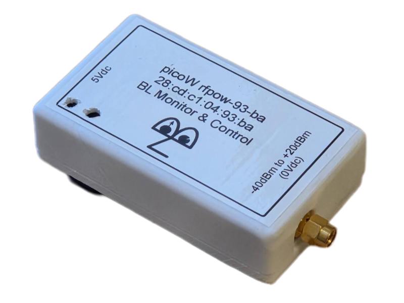 |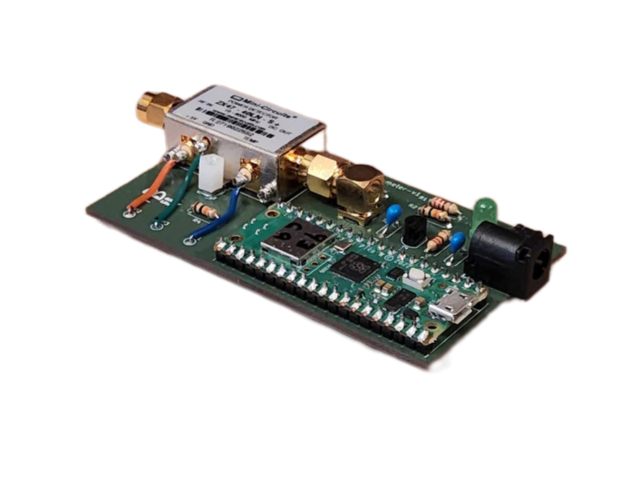| [RF Power Meter Cube](https://github.com/bl-instr/rf-power-meter-cube) | RF power measurement and alarm reporting. |
|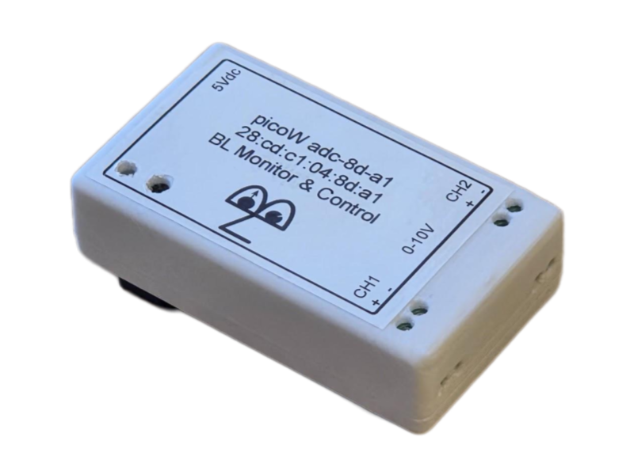 |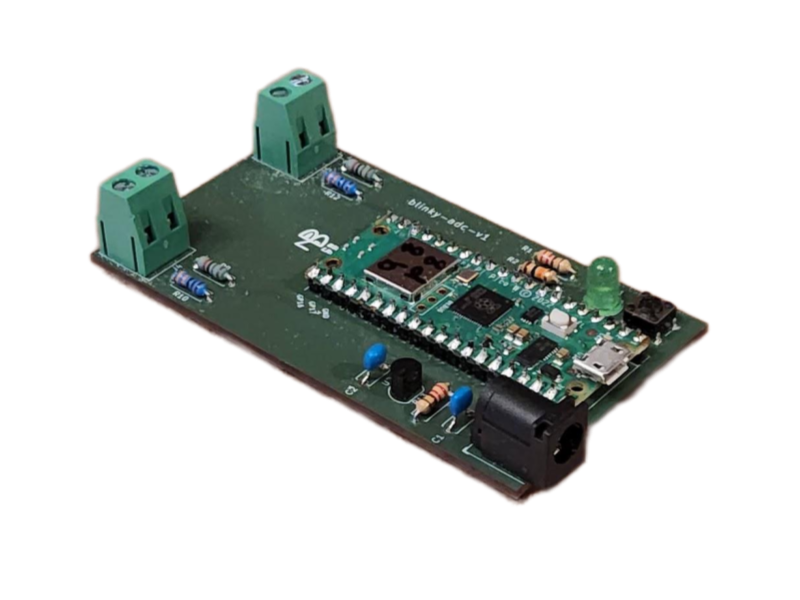| [ADC Cube](https://github.com/bl-instr/adc-cube) | Two-channel 0–10 V analog acquisition with configurable digital filtering and engineering-unit scaling. |
| |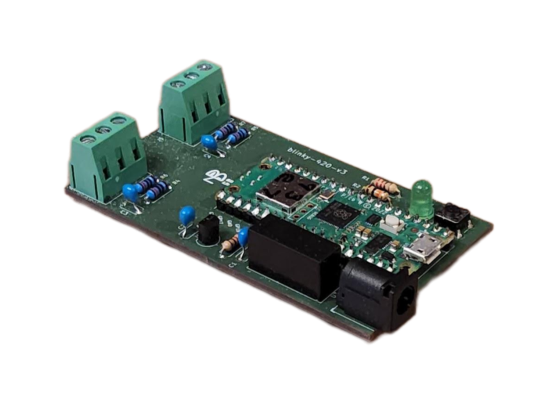| [4–20 mA Cube](https://github.com/bl-instr/420-cube) | Two-channel industrial current-loop acquisition with 24 V field-device supply connections. |
|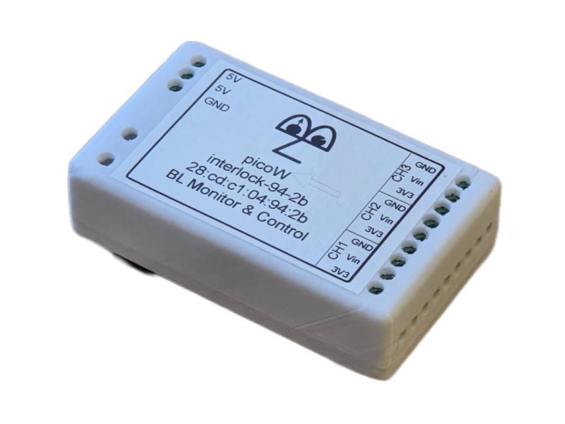 |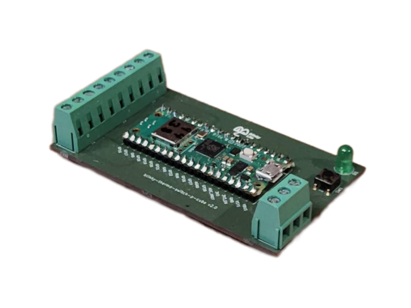| [Interlock Cube](https://github.com/bl-instr/interlock-cube) | Three-channel configurable monitoring of switch closures and digital interlock states. |
|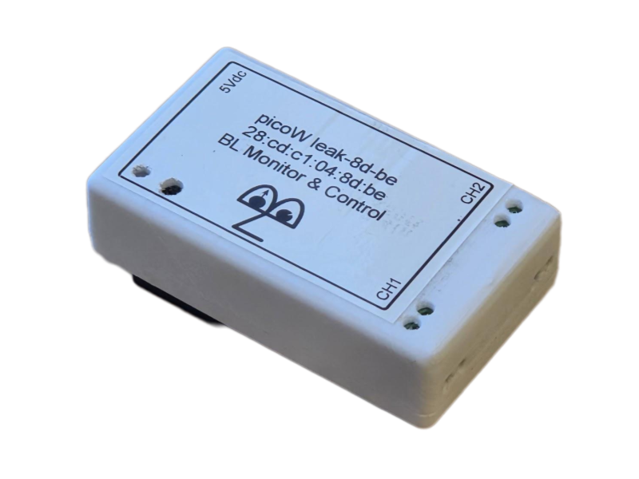 || [Leak Cube](https://github.com/bl-instr/leak-cube) | Two-channel resistive water-leak detection and detector-integrity monitoring. |
|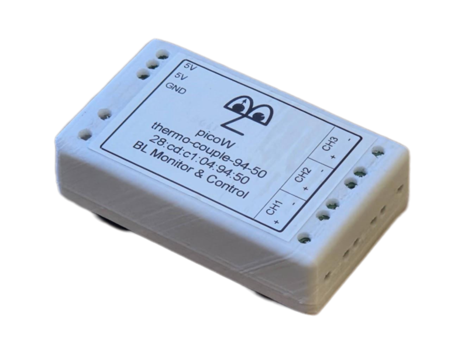 |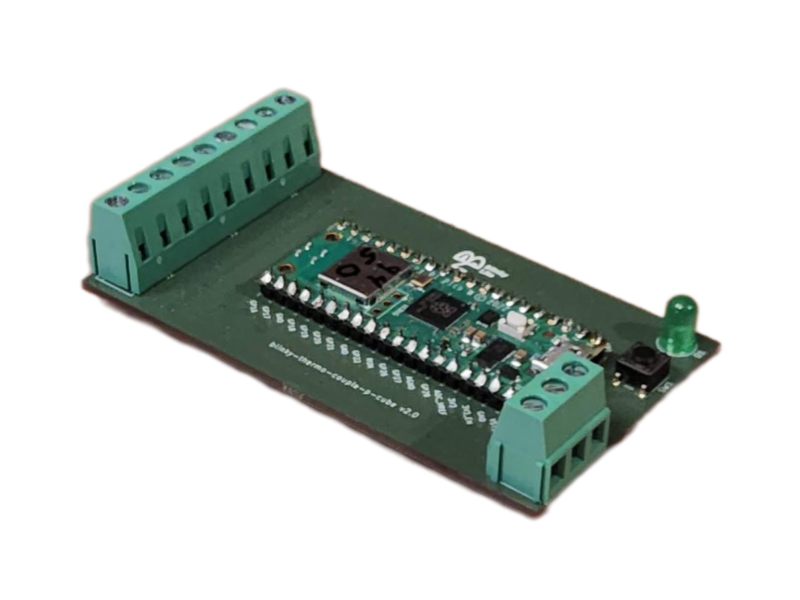| [Thermocouple Cube](https://github.com/bl-instr/thermocouple-cube) | Three-channel K-type thermocouple temperature measurement. |
| || [DS18B20 Cube](https://github.com/bl-instr/DS18B20-cube) | Three-channel rugged digital temperature measurement using DS18B20 sensors. |
|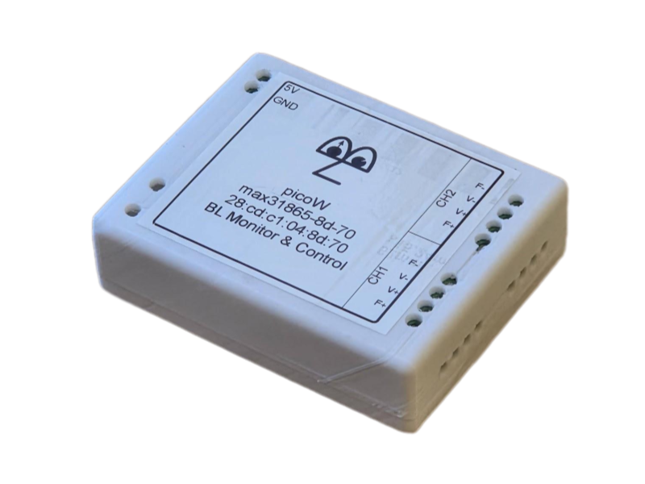 |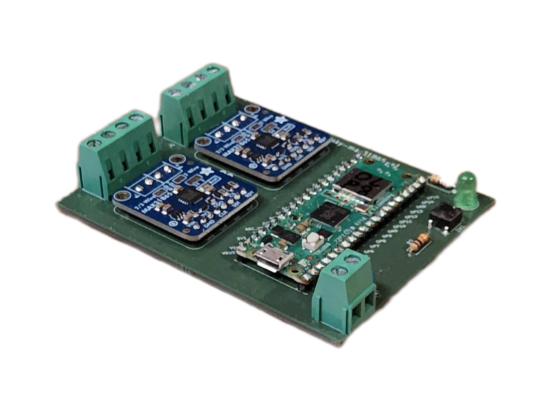| [MAX31865 Cube](https://github.com/bl-instr/MAX31865-cube) | Two-channel precision four-terminal resistance thermometry, including cryogenic applications. |
| |  | [Klockanar Cube](https://github.com/bl-instr/klockanar-cube) | A configurable 48-LED light ring for engineers who want a fun, wireless Blinky-Lite project. |

## Integration model

Each Cube connects by Wi-Fi to the local network and communicates through an MQTT broker. Rather than relying on conventional polling, the platform uses event-driven reporting so that new measurements, state transitions, alarm conditions, and faults can be delivered promptly to Blinky-Lite.

Within Blinky-Lite, Cubes are represented as integrated instrumentation nodes. Their data can be recorded, displayed in engineering units, compared against configured thresholds, used to trigger notifications, and incorporated into interlock or machine-protection logic where appropriate.

### Deployment and customisation

Select the Cube that matches the required sensor or control interface, install it close to the field device, configure Wi-Fi and MQTT connectivity, then set device-specific scaling, calibration, filters, thresholds, and logic in Blinky-Lite. Cube READMEs provide connection details, operating limits, installation guidance, and commissioning steps for each module.
The MIT-licensed firmware and open hardware approach support custom integrations, specialised interfaces, and site-specific adaptations while retaining a consistent Blinky-Lite communications and control-system foundation.

